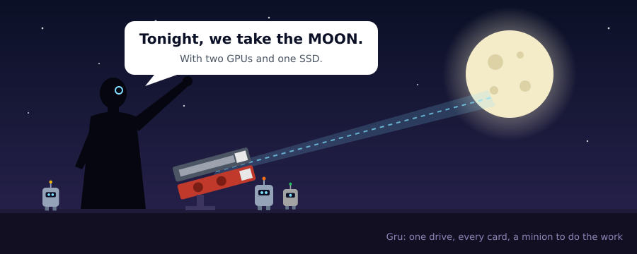

# Gru

**Gru runs the minions.** Put your models, engines and this folder on one drive and carry it from
PC to PC. Gru finds the graphics cards, starts an inference engine on each one, gives the second card
side jobs, keeps every card from cooking itself, and then hands you
[minion](https://github.com/Sentdex/minion), a small coding agent for self-hosted models. You can talk
to it in the terminal, or from your phone through the llama.cpp chat page.

The goal: plug the drive into a new Linux PC and have a local coding agent running in under five
minutes, with no system services, no installs into your home folder and nothing left behind.

> **Work in progress.** It grew out of a pile of bash launchers and services on one PC, and those
> parts are being moved into Gru one script at a time. [What works today](#status) is listed below.

## Why Gru exists

I run local models on a PC with two secondhand AMD cards: a water-cooled RX 6900 XT and a Radeon Vega
Frontier Edition, 32 GB of VRAM between them. Getting a coding agent going on that box meant:

- starting the right engine with the right flags for each model and context size,
- putting the second card to work instead of letting it idle,
- watching temperatures, because both cards have overheated and hung at stock settings,
- running fan curves based on the temperatures that matter, not the ones the BIOS reads,
- sandboxing the agent so it can run unattended in `--yolo` without touching the rest of the disk,
- checking on long runs from another room,
- and stopping all of it cleanly when I'm done.

That ended up as about eight separate scripts and systemd units, each with hard-coded paths and PCI
slots. A fix in one kept breaking another, and I lost track of what the engine was actually doing.
Gru puts all of it back in one folder with one config file, where every part is a readable script.

## The pieces, and why each one

### The agent: minion

[minion](https://github.com/Sentdex/minion) by sentdex is one Python file whose only dependency is
`openai`. It talks to any OpenAI-compatible server, so llama.cpp and Strata both work, and it has no
TUI framework underneath. That matters here because:

- **It's small enough to read and change.** A local model needs an agent tuned to its quirks: tool
  calls with broken closing tags, turns that announce a step and then stop, context that fills up
  mid-run. In a single file I can fix each of those in place and keep track of the fixes.
- **Its base prompt is small** (under about 1K tokens). On a local model, every token in the system
  prompt costs prompt-processing time.
- **It runs anywhere Python does**, even on systems where the package manager is locked. That
  suits a drive you plug into a PC you don't own.

`minion.py` here is sentdex's agent plus my additions: a live nudge box, sub-agents, MCP servers,
background helpers on a second card, goal mode, remote chat, auto-compaction fixes and more. **Each
addition sits behind a `MINION_*` switch**, so with the switches off it behaves like stock minion.
Run `python3 minion.py --features` to list them. The small bug fixes are being prepared as PRs for
upstream.

### The engines: llama.cpp and Strata

- **[llama.cpp](https://github.com/ggml-org/llama.cpp)'s `llama-server`** runs on any card, using
  Vulkan or ROCm/HIP. Each card names the engine it prefers: on the Vega, the Vulkan build reads
  prompts much faster than HIP does (about 370 vs 80 t/s at 25K context).
- **Strata** is a MoE engine. On the 6900 XT alone it decodes about 3× faster than llama.cpp split
  across both cards (around 42 t/s against 14 at 82K context). It doesn't support the Vega, so the
  second card runs llama.cpp next to it.

Engine settings live **next to the model**: a `minion.conf` (llama.cpp flags per context size, env
vars, `MINION_*` switches) and, for Strata, a `strata.json` holding its full command line. Copy a
model folder to another drive and its settings go with it.

### The second card: an assistant, not a split

Since the fast card on its own beats a split, the second card runs a smaller model of its own. That
model works *beside* the main one and never makes it wait:

- **review**: reads each edit the main model makes and flags problems.
- **coach**: notices when the main model goes in circles, for example the same shell-quoting error
  five times, and suggests a way out.
- **compact**: summarizes old turns in the background, so the context stays small without a pause.
- **agents**: sub-agents for side work the main model doesn't need right away.
- **describe, embed, rerank**: session titles, plus code search through an MCP server.

Two different models working on one goal catch more than one model alone. The helper loads on first
use and unloads after an idle timeout, so it frees its VRAM when nothing needs it.

### The web UI: llama.cpp's own chat page

For remote use, Gru serves the **chat page that ships inside `llama-server`**, unmodified, and connects
it to minion instead of to the model. Your message goes to the running agent, and the reply streams
back with its thinking, tool calls and their output.

Why that page instead of writing a new one:
- It's a good chat UI already: markdown, code blocks, history, mobile layout, resumable streams.
- It's MIT-licensed and maintained by the llama.cpp project, so it keeps improving without me.
- People who run local models already know it.

On top of it, Gru adds a small sync script (it loads minion's sessions into the page's history) and a
status bar (CPU and GPU temperatures, tokens per second, context use, helper load, running agents).
Lock your phone mid-reply and the stream picks up where it left off. Access is limited to loopback
and your Tailscale network by default.

### Thermal guard and fan curves

This is the part that keeps the hardware alive. On this PC, at stock settings:
- the 6900 XT hit **108 °C junction**,
- the Vega's stock fan curve follows its *edge* temperature, which ran about 35 °C below its
  *junction*. The junction reached 105 °C, the card hung, and it **dropped off the PCIe bus** until a
  cold reboot.

So Gru runs two guards while an engine is up:

- **Thermal guard**: samples every card's junction and memory temperature once a second. Past a
  per-card limit, or when a card stops reporting (it may have fallen off the bus), it stops the engine
  before the card locks up. Processes are matched by exact name, never by pattern, so it can't kill a
  shell that only mentions them.
- **Fan curves**: drive the case fans from the hottest of GPU junction and CPU, and the Vega's blower
  from its own junction, with hysteresis and a limit on how fast duty can change. If a sensor read
  fails, that group of fans goes to 100%. On exit, control goes back to the driver and BIOS.

Both find cards and fan headers by PCI ID, not by slot. When I swapped the motherboard, every card
moved to a new bus address, and scripts that used slot numbers would have guarded the wrong thing or
nothing.

### The sandbox

Agents running unattended guess paths like `/home/user` and try things. Gru runs minion in a
[bubblewrap](https://github.com/containers/bubblewrap) box: `/` read-only, home and other mounts
empty, only the project folder writable, with its own PID namespace. It sets no RAM cap, because the
models need all of it.

## Design rules

- **One folder, one config file.** `gru.toml` lists your engines and your cards, and it finds the cards
  by PCI ID. Paths in it are relative to the file, so the drive can mount anywhere.
- **One script per part, named for what it does.** `thermal_guard.py`, `fan_curves.py`,
  `web_ui.py` and so on. `gru_config.py` is the only shared file.
- **Delete a script and that part is off.** No part imports another, and nothing else breaks.
- **Model settings live in the model folder**, not in Gru.
- **No system services, no installs.** Everything runs from the drive and stops when you're done.
- **Standard library only**, plus `openai` for the agent. Linux first, Python 3.11+.

## Status

Works today:

- `gru_config.py` reads `gru.toml` and finds the cards. Run `python3 gru_config.py` to see what this
  PC has.
- `engine_strata.py` runs Strata straight from the model folder's `strata.json`, with `status`,
  `flags` and `import`.
- `minion.py` is the agent, described above.

Running on my PC as older standalone scripts, being moved in: `start.py` (pick a model, it starts
everything and stops everything afterwards), `engine_llamacpp.py`, `assistant_gpu.py`, `sandbox.py`,
`detached_runs.py`, `thermal_guard.py`, `fan_curves.py` and `web_ui.py`.

New: `setup_wizard.py` (optional). It will benchmark your cards, pick the main one by generation speed
rather than VRAM, and write `gru.toml`.

To try it now: copy `gru.example.toml` to `gru.toml`, edit it, and run `python3 gru_config.py`.

## Credits

Most of what Gru runs was made by other people: minion by sentdex, `llama-server` and its web UI by
the llama.cpp authors, and Strata by its own authors. See [CREDITS.md](CREDITS.md) for details and
licenses.

The name comes from Gru and his Minions. The picture above is an original drawing, not him.
